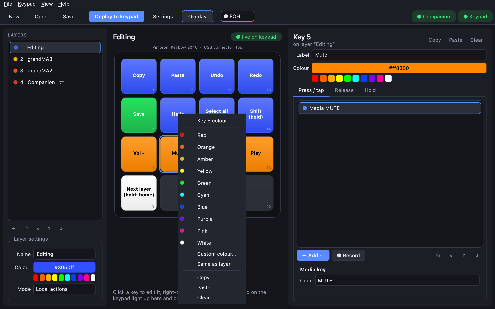
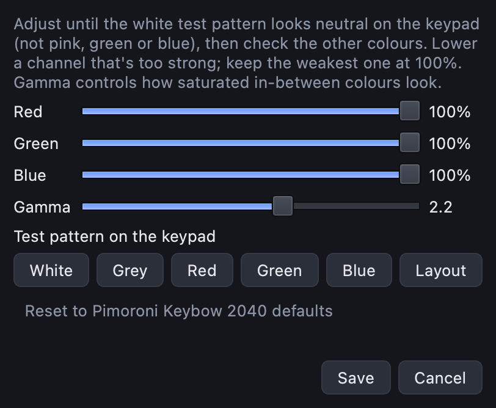

# Colours and LEDs

Every key's LED shows its colour, so you can find keys by colour at a glance. The same colours
appear in the editor and on the overlay.

## Colour a key

Pick the key, then either:

- **right-click** it on the pad and choose a colour, **Custom colour…**, or **Same as layer**;
- or use the **Colour** row in the key panel: click the big button for any colour, or one of the
  swatches under it. Right-clicking the big button resets it to the layer's colour.

## Colour a layer

In **Layer settings** (bottom-left), set **Colour**. Every key on that layer without its own colour
uses it. Keys that have their own colour keep it, so if you change the layer to red and some keys
stay orange, those keys have their own colour: right-click them and choose **Same as layer**.

## Changes show on the keypad straight away

Colour changes appear on the keypad's LEDs as you make them, before you deploy. Everything else,
such as what a key does, only changes on the keypad when you click **Deploy to keypad**, which shows
a **•** while there are changes the keypad doesn't have yet. Deploy also keeps the colours after the
keypad restarts.

A key lights up once it has an action, a label or its own colour. A completely empty key stays
dark, even on a coloured layer.

## Pressed keys and brightness

In **Settings → Keypad**:

- **LED brightness** (0–1) dims or brightens every key.
- **Pressed colour** is the colour a key flashes while held (white by default).

## LED colour balance

LEDs don't all show colours the same way. On some keypads white looks pink, or green looks cyan.
**Keypad → LED colour balance…** fixes that for your keypad:

1. With the **White** test pattern on the keypad, lower the channel that's too strong until white
   looks neutral. Keep the weakest channel at 100 %.
2. Check the other patterns (**Grey**, **Red**, **Green**, **Blue**), and **Layout** to see your real
   keys.
3. **Gamma** changes how saturated in-between colours look. 2.2 suits most LEDs.
4. Click **Save**, then **Deploy** so the keypad keeps it after restarting.

The balance is saved for **that keypad** (by its hardware ID), not in the layout, so a layout shared
between keypads looks right on each one. **Reset to … defaults** goes back to your keypad model's
defaults.
