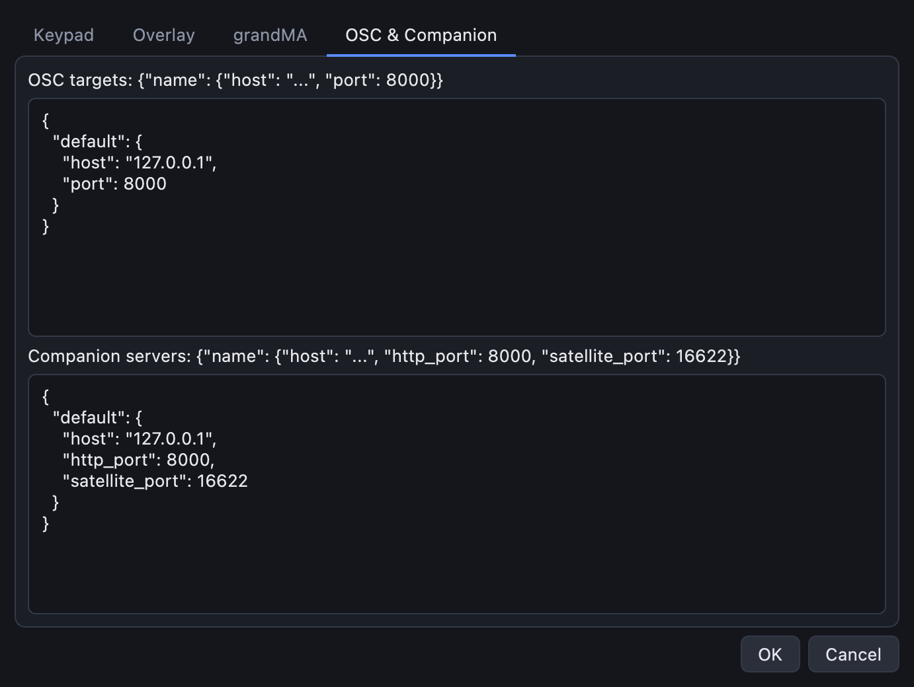
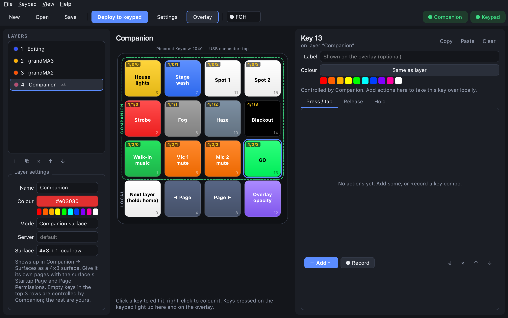
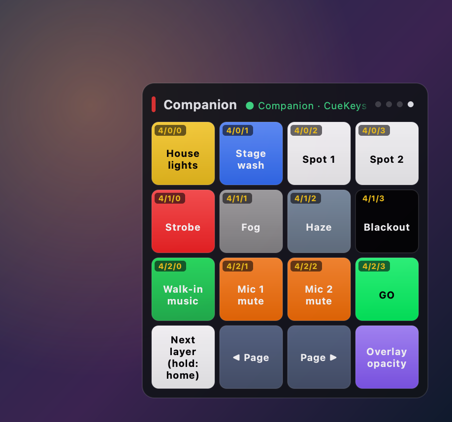

# Bitfocus Companion

[Companion](https://bitfocus.io/companion) controls almost anything: video switchers, media
players, lighting, audio, PTZ cameras. CueKeys can use it in two ways:

- **A Companion layer:** part of the keypad becomes a Companion *surface*, like a Stream Deck.
  Companion decides what those keys do and what they look like, and you edit them in Companion.
- **A Companion button action:** one key presses one specific Companion button.

Both need the CueKeys app running, since it talks to Companion over the network.

## 1. Tell CueKeys where Companion is

**Settings → OSC & Companion**, under **Companion servers**. For Companion on the same computer the
default already works:

```json
{"default": {"host": "127.0.0.1", "http_port": 8000, "satellite_port": 16622}}
```

For Companion on another machine, change `host` to its IP address. `http_port` is the port of
Companion's web page; `satellite_port` stays 16622 unless you changed it in Companion.



## 2. Make a Companion layer

1. Add a layer (**＋** under Layers), or pick one.
2. In **Layer settings**, set **Mode** to **Companion surface**.
3. Choose the **Surface** size. The default, **4×3 + 1 local row**, gives Companion the top three
   rows and keeps the bottom row for your own keys (layer switch, page buttons…). **4×4 whole pad**
   gives Companion every key.

The toolbar's **Companion** pill turns green when CueKeys is connected. Companion's buttons appear in
the editor, on the keypad's LEDs and on the overlay, with Companion's page/row/column in the corner
of each key:



Keys in the Companion area that you give your own actions stay yours; everything else belongs to
Companion.

## 3. Give the surface its own pages (in Companion)

The surface shows up in Companion under **Surfaces** as *CueKeys &lt;keypad&gt; · &lt;layer&gt;*. So
your keypad doesn't take over pages meant for other surfaces:

1. In **Buttons**, add pages for the keypad at the end, for example *CueKeys 1* and *CueKeys 2*.
   Companion's grid must be at least 4×3.
2. In **Surfaces**, click the CueKeys surface and:
   - turn off **Use Last Page At Startup**;
   - set **Startup Page** to your first CueKeys page;
   - turn on **Restrict pages accessible to this surface** and choose your CueKeys pages.

## 4. Page buttons and the overlay

In the demo layout, the Companion layer's bottom row has:

- **◀ Page** / **Page ▶** (**Companion page** action): step through the pages the surface may use.
  Needs Companion 4.3 or newer.
- **Overlay opacity**: cycles the overlay through 90 %, 60 %, 30 % and hidden.

The overlay header shows the page's name:



## Pressing one Companion button

On any layer, **＋ Add → Companion button** presses the button at a **page**, **row** and **column**
(Companion's own numbering, as shown on its buttons, starting at 0 for rows and columns). In **hold**
mode (the default) Companion's button is held down for as long as you hold the key; **press** sends
a single press.

## Several Companion layers, several keypads

Each Companion layer is its own surface with its own pages, and so is each keypad: two keypads with
the same layout show up as two surfaces. A keypad's surface ID comes from its hardware ID, so
Companion recognises it (and keeps its page settings) even when it's plugged into another computer
that uses the same Companion. More detail for developers: [docs/companion.md](../companion.md).
