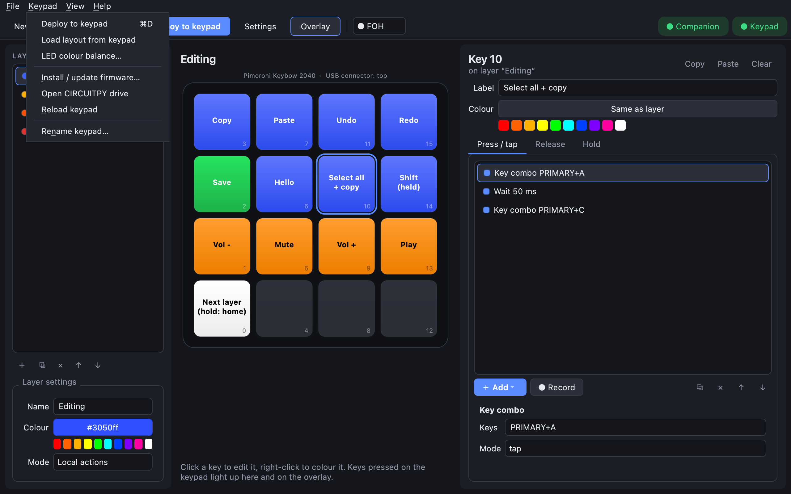
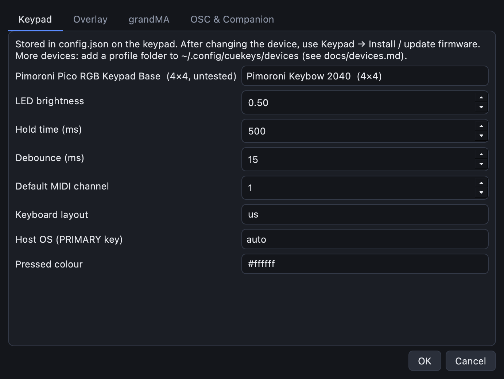
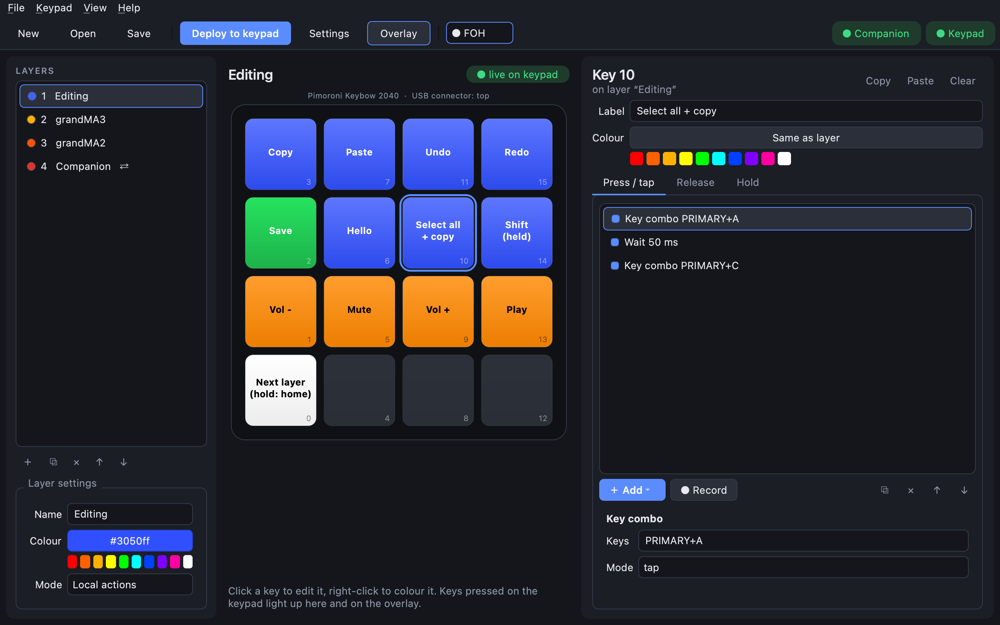

# Getting started

You'll install the CueKeys app, put the CueKeys firmware on your keypad, and send it a layout. It
takes about ten minutes. You need a supported keypad (for example a Pimoroni **Keybow 2040**) and a
USB cable that carries data, not just power.

## 1. Install the app

Download the zip for your computer from the project's **Releases** page and unzip it:

| Download | For |
|---|---|
| `cuekeys-<version>-macos-universal2.zip` | macOS 13 or newer (Intel and Apple Silicon) |
| `cuekeys-<version>-windows-x86_64.zip` | Windows 10/11 on Intel/AMD |
| `cuekeys-<version>-windows-arm64.zip` | Windows 11 on ARM |
| `cuekeys-<version>-linux-x86_64.zip` | 64-bit Linux (Ubuntu 24.04+, Debian 13+, Fedora 40+) |
| `cuekeys-<version>-linux-arm64.zip` | Raspberry Pi 4/5 with 64-bit Raspberry Pi OS trixie or newer |

The apps aren't code-signed yet:

- **macOS:** right-click **CueKeys** and choose **Open** the first time, then **Open** again.
- **Windows:** when SmartScreen appears, click **More info → Run anyway**.

On an older Linux, install from Python instead: `pip install "cuekeys[gui]"`, then run `cuekeys`.

## 2. Put CircuitPython on the keypad

Skip this if your keypad already shows up as a drive called **CIRCUITPY**.

1. Download CircuitPython 9 or newer for your board: [Keybow 2040](https://circuitpython.org/board/pimoroni_keybow2040/),
   or [Raspberry Pi Pico](https://circuitpython.org/board/raspberry_pi_pico/) for the Pico RGB Keypad Base.
2. Hold the keypad's **BOOT** button while plugging it in. A drive called **RPI-RP2** appears.
3. Drag the `.uf2` file onto it. The keypad restarts and **CIRCUITPY** appears.

## 3. Install the CueKeys firmware

1. Download `cuekeys-firmware-<version>.zip` from the Releases page.
2. Unzip it and copy **everything inside** onto the **CIRCUITPY** drive, replacing what's there. It
   contains the firmware and every library it needs.
3. **Unplug the keypad and plug it back in.** This step matters: it turns on the second USB serial
   port the app talks to, and that only happens after a real restart.

Already have the libraries on the drive? The app can copy just the firmware:
**Keypad → Install / update firmware…**

## 4. Open the app and pick your keypad model

Start CueKeys. The **Keypad** pill in the top-right corner turns green when it finds your keypad.

If you use something other than a Keybow 2040, open **Settings → Keypad** and choose your model
under **Device**:

## 5. Edit and deploy

The editor shows your keypad as it looks on your desk (USB connector at the top):

- **Left:** layers, which are pages of keys. See [Layers](layers.md).
- **Middle:** the keypad. Click a key to edit it; right-click it to colour it.
- **Right:** the selected key's label, colour, and what it does when pressed, released or held.

When you're happy, click **Deploy to keypad** (Ctrl+D, or Cmd+D on a Mac). The keypad reloads by
itself in a second or two. The button shows a **•** while you have changes the keypad doesn't have
yet.

Save your layout with **File → Save**. Layouts are ordinary JSON files: keep them anywhere, back them
up, share them.

**Next:** try [making a key that locks your computer](lock-your-computer.md).
