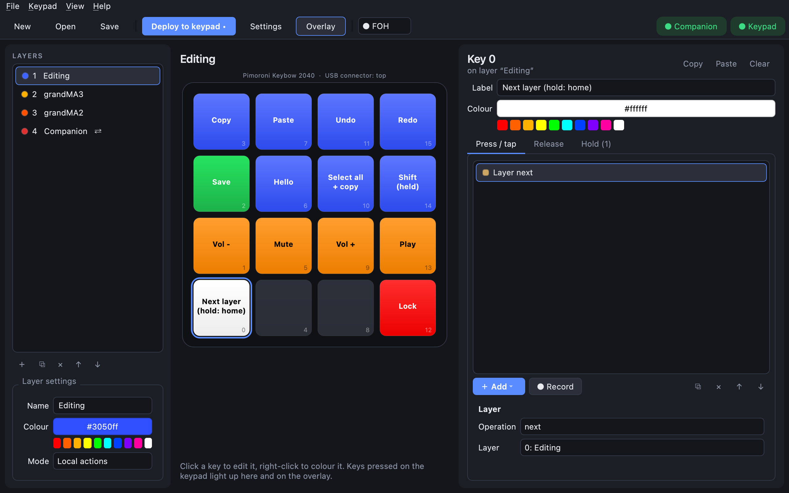

# Layers

A layer is a full page of keys. With layers, a 16-key pad can hold as many keys as you like: one
layer for editing shortcuts, one for your lighting console, one for Companion, and so on. The
keypad's LEDs, the editor and the overlay always show the current layer.

## Add and arrange layers

The **Layers** list is on the left of the editor. Under it:

| Button | Does |
|---|---|
| **＋** | adds a layer |
| **⧉** | duplicates the selected layer, keys and all |
| **✕** | removes it |
| **↑ ↓** | moves it (layer numbers follow the order) |

**Layer settings** below the list set the layer's name, its colour (used by every key that doesn't
have its own colour) and its mode: **Local actions**, or **Companion surface** (see
[Bitfocus Companion](companion.md)).

Clicking a layer in the list also switches the keypad to it, so you can see it on the LEDs. Turn that
off with **View → Sync selected layer to keypad**.

## Keys that change layer

Add a **Layer** action to a key. Its **Operation** decides what happens:

| Operation | When pressed |
|---|---|
| **next** / **prev** | goes to the next / previous layer, wrapping around |
| **goto** | goes to the chosen layer |
| **toggle** | goes to the chosen layer; pressed again, goes back to where you were |
| **momentary** | shows the chosen layer only while you hold the key, like a Shift key for layers |

The demo layout puts the same key on every layer, bottom-left: a tap goes to the **next** layer and
holding it goes back to the first layer (**goto**, on the **Hold** tab). That way you can never get
lost.

> **Tip:** give every layer a way out. The easiest is to duplicate a layer that already has your
> layer key, then change the other keys.

## From the computer

- In the editor: **View → Next layer** (Ctrl+], or Cmd+] on a Mac) and **Previous layer** (Ctrl+[ / Cmd+[).
- On the overlay (when **click-through** is off in its settings): scroll to change layer, or
  right-click it for the next layer.
