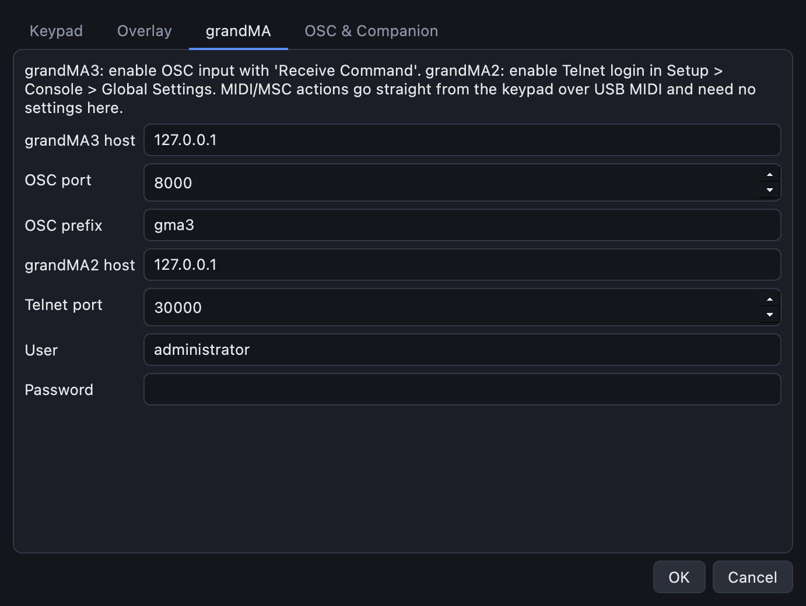
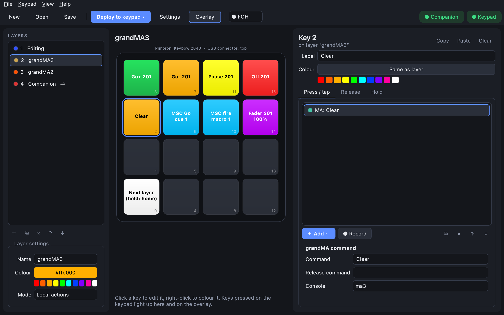
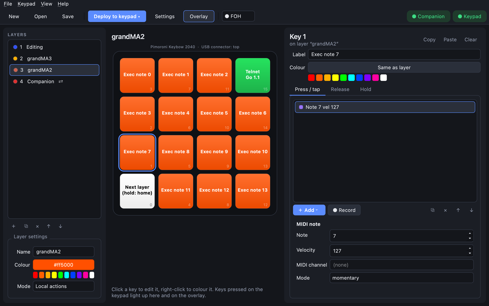

# Lighting consoles: grandMA and MIDI

CueKeys can drive a lighting console in four ways. Pick by what your console supports and whether
the CueKeys app will be running:

| Method | Works with | App must run? | Best for |
|---|---|---|---|
| **grandMA command** over OSC | grandMA3 (console or onPC) | yes | any command line text: `Go+ Executor 201`, `Clear`, macros |
| **grandMA command** over Telnet | grandMA2 | yes | the same, on MA2 |
| **MIDI note** / **MIDI CC** | anything with MIDI remotes | **no** | executor buttons and faders mapped to notes |
| **MIDI Show Control** | anything with MSC In | **no** | Go / Stop / Resume a cue list, fire a macro |

MIDI actions go straight from the keypad over USB-MIDI: the keypad shows up on the computer or
console as a MIDI device, even with no app running. grandMA commands and OSC are sent by the app over
the network.

The demo's **grandMA3** and **grandMA2** layers show examples of each.

## grandMA3 commands (OSC)

**On the console** (or onPC): **Menu → In & Out → OSC**. Add an input on the port you'll use (8000
by default), and tick **Receive** and **Receive Command**. Note the **prefix** (`gma3` by default).

**In CueKeys:** **Settings → grandMA** → *grandMA3 host* (the console's IP address), *OSC port* and
*OSC prefix*:

**On a key:** **＋ Add → grandMA command**, set **Console** to **ma3**, and type the command exactly
as you would on the command line:

**Release command** runs when you let go, which makes flash buttons: *Command* `Go+ Executor 201`,
*Release command* `Off Executor 201`.

For something the command line can't do, such as setting a fader, use an **OSC message** action:
the demo's **Fader 201 100%** key sends `/gma3/Page1/Fader201` with `[100]` on press and `[0]` on
release.

## grandMA2 commands (Telnet)

**On the console:** **Setup → Console → Global Settings → Telnet: Login Enabled**.

**In CueKeys:** **Settings → grandMA** → *grandMA2 host*, *Telnet port* (30000), *User*
(`administrator` by default) and *Password*.

**On a key:** **＋ Add → grandMA command** with **Console** set to **ma2**. The demo's green
**Telnet Go 1.1** key sends `Go Executor 1.1`.

## MIDI notes

**On a key:** **＋ Add → MIDI note**. Set the **Note** and **Velocity**, and the **Mode**:

| Mode | Behaviour | Use for |
|---|---|---|
| **momentary** | note on while held, note off on release | executor *flash* / *temp* buttons |
| **tap** | a short note on + off | *go* buttons |
| **toggle** | first press note on, second press note off | *toggle* buttons |

**MIDI channel** is optional; empty means the default channel from **Settings → Keypad → Default
MIDI channel**.

**On the console:** add the keypad as a MIDI input (it shows up as a USB MIDI device named
after your board or CircuitPython, depending on the system), then map notes to executors under **MIDI Remotes**.

**MIDI CC** works the same way for faders and encoders; set a **Release value** to send another value
when you let go.

## MIDI Show Control (MSC)

**On a key:** **＋ Add → MIDI Show Control**, then pick the **Command** (`go`, `stop`, `resume`,
`fire`, …) and fill in what it needs: a **Cue** such as `1.5`, a **Cue list**, or a **Macro** number
for `fire`.

**On the console:** turn on **MSC In**. The **Device ID** and **Command format** must match on both
sides; CueKeys sends to device **127** (all devices) with format **all** by default, which every
console accepts. On grandMA2 in *Exec.Page* mode, the cue list is written `executor.page`, for
example `1.1`.
