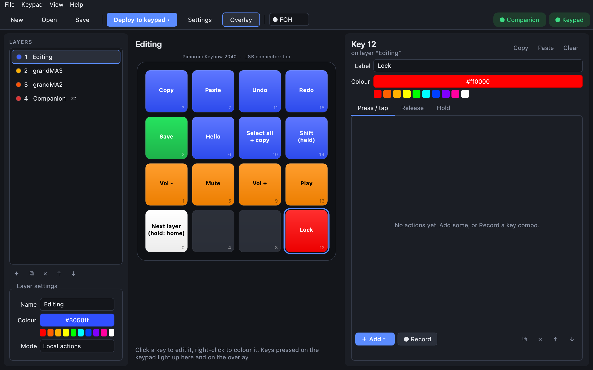
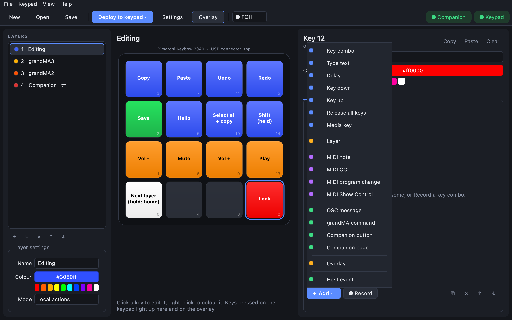
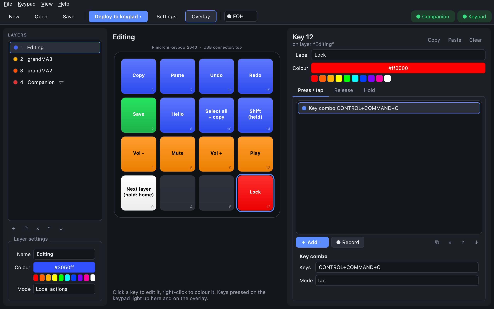
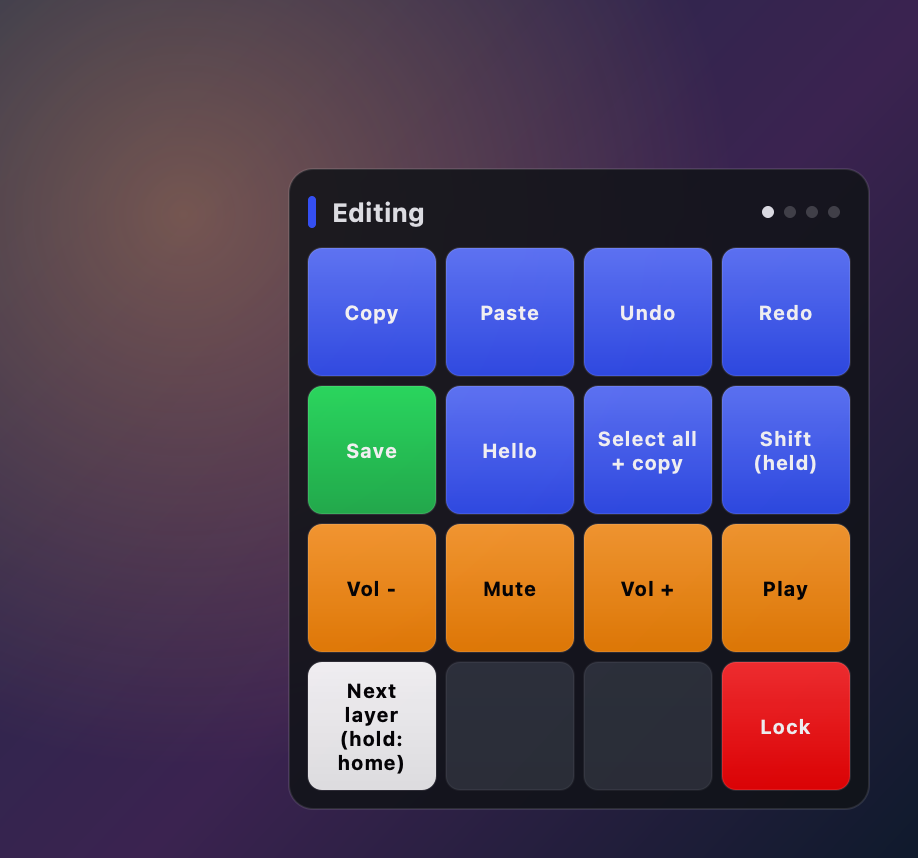

# Lock your computer with one key

Make a key that locks your screen, like pressing the lock shortcut yourself. It works without the
CueKeys app running: the keypad types the shortcut as a USB keyboard.

| Computer | Shortcut | Type it in CueKeys as |
|---|---|---|
| **Mac** | Control + Command + Q | `ctrl+cmd+q` |
| **Windows** | Windows + L | `win+l` |
| **Linux** (GNOME, KDE, most desktops) | Super + L | `super+l` |

This guide uses the Mac shortcut. For Windows or Linux, type that row's shortcut instead in step 4.

## 1. Pick an empty key

Click an empty key on the keypad in the middle of the editor. Here it's key 12, bottom-right.

## 2. Name it and colour it

- In **Label**, type `Lock`. The label shows on the key in the editor and on the overlay.
- Click the red swatch under **Colour**. (Or right-click the key and choose **Red**.)

The key turns red on your keypad straight away.

## 3. Add a key combo

Under **Press / tap**, click **＋ Add** and choose **Key combo**:

## 4. Enter the shortcut

In **Keys**, type `ctrl+cmd+q`. It's saved as you type, and shows as `CONTROL+COMMAND+Q` the next
time you select the key. Leave **Mode** on **tap**.

> **Type it, don't record it.** The **● Record** button can't capture lock shortcuts: macOS (and
> Windows) act on them before any app sees them.
>
> **Why not `PRIMARY`?** `PRIMARY` means Cmd on a Mac and Ctrl elsewhere. It's great for Copy and
> Paste, but lock shortcuts differ by more than that, so use the exact keys for your computer.

## 5. Deploy and try it

Click **Deploy to keypad** (Cmd+D). After the keypad reloads, press the red **Lock** key: your Mac
locks. Unlock it with Touch ID or your password as usual.

The key also shows on the overlay, so you can find it at a glance:

## Variations

- **Only lock when held:** move the combo to the **Hold** tab instead of **Press / tap**, so a quick
  tap does nothing and holding the key for half a second locks. Handy if the key is easy to knock.
  See [tap vs hold](macros.md#tap-and-hold).
- **One layout for a Mac and a PC:** put the Mac lock on one layer and the Windows lock on another,
  or on the same key's **Press** and **Hold**.
