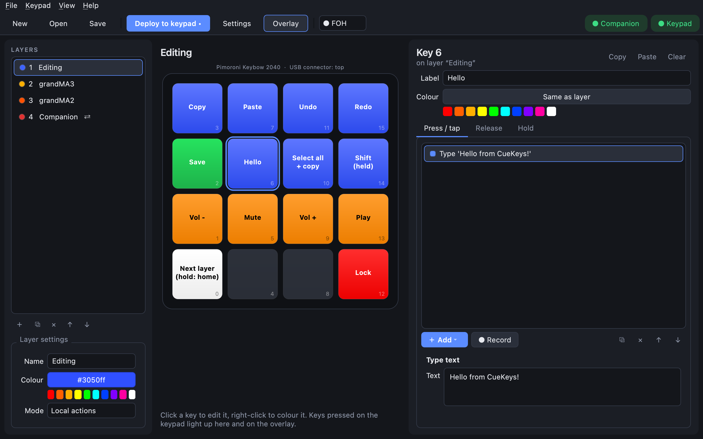
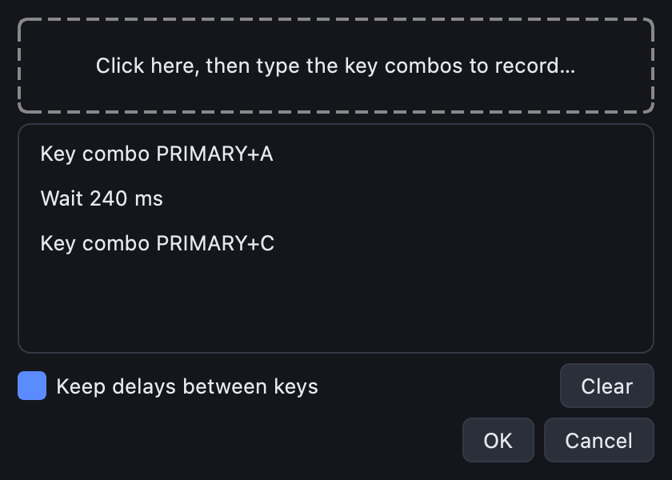
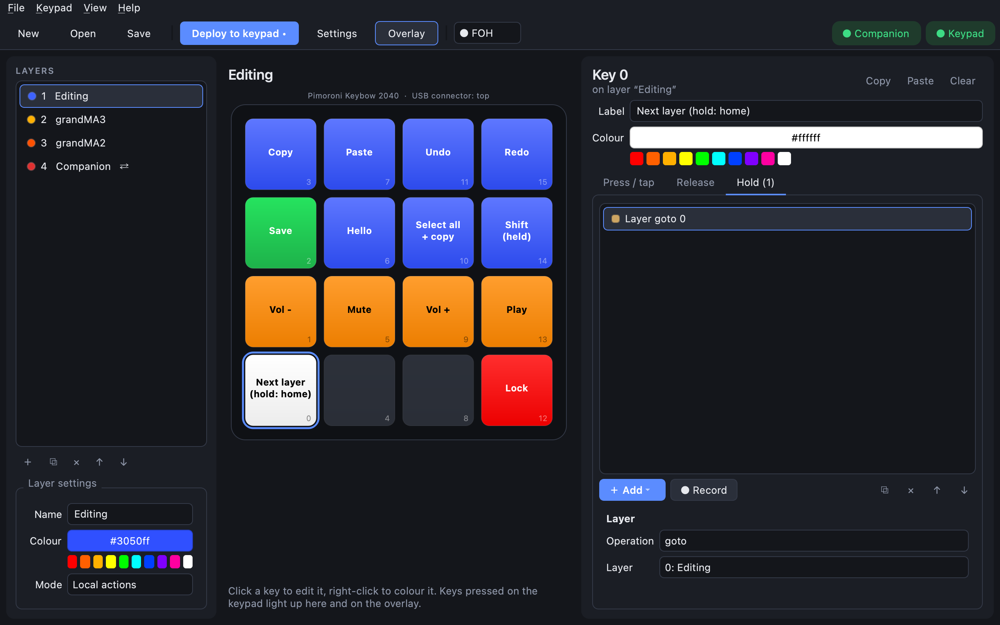

# Macros, text and hold keys

A key can do a whole sequence of things. Each key has three lists of actions, one per tab:

| Tab | Runs when |
|---|---|
| **Press / tap** | the key goes down. If the key also has **Hold** actions, it runs on a short tap instead. |
| **Release** | the key comes back up |
| **Hold** | the key has been held for the hold time (500 ms by default; **Settings → Keypad → Hold time**) |

Add actions with **＋ Add**, reorder them with ↑ ↓, and remove them with ✕. They run top to bottom.

## Keyboard actions

| Action | What it does | Example |
|---|---|---|
| **Key combo** | Presses keys together and lets go. In **hold** mode the keys stay down while you hold the button. | `PRIMARY+S` to save |
| **Type text** | Types text as if you typed it | an email signature |
| **Delay** | Waits, in milliseconds (up to 60 s) | give an app time to open a menu |
| **Key down** / **Key up** | Holds keys down / lets them go, for sequences a combo can't express | hold Shift across several actions |
| **Release all keys** | Lets go of everything | the end of a long macro |
| **Media key** | Play/pause, stop, next/previous track, fast-forward, rewind, record, eject, mute, volume up/down, brightness up/down | volume knob-style keys |

### Key names

Type combos with `+` between keys, in any case: `ctrl+shift+s`, `PRIMARY+Z`, `f5`. Handy names:

- **`PRIMARY`**: Cmd on a Mac, Ctrl on Windows and Linux. Use it for everyday shortcuts (copy, paste,
  save, undo) so one layout works on every computer. The app tells the keypad which computer it's
  plugged into; set **Settings → Keypad → Host OS** if the keypad is used without the app.
- Modifiers: `CTRL` / `CONTROL`, `SHIFT`, `ALT` / `OPTION`, `CMD` / `COMMAND`, `WIN` / `WINDOWS`,
  `SUPER` / `GUI`.
- Others: `ENTER`, `ESC`, `TAB`, `SPACE`, `BACKSPACE`, `DEL`, `UP` / `DOWN` / `LEFT` / `RIGHT`, `PGUP` / `PGDN`, `F1`–`F24`, digits and letters.

The Keys box suggests names as you type.

## Example: type text

The demo's **Hello** key types a sentence:

Typed text assumes a **US keyboard layout** on the computer. For another layout, set
**Settings → Keypad → Keyboard layout** (for example `win_de` or `mac_fr`) and copy the matching
`keyboard_layout_*` file from the CircuitPython community bundle into the keypad's `lib` folder.

## Example: a multi-step macro

The demo's **Select all + copy** key runs three actions: **PRIMARY+A**, a **50 ms delay**, then
**PRIMARY+C**:

## Record a macro

Instead of adding combos one by one, click **● Record**, click the dashed box, and type the
shortcuts. Tick **Keep delays between keys** to keep your timing. Cmd (on a Mac) is recorded as
`PRIMARY`, so the macro also works on Windows and Linux.

Some shortcuts can't be recorded because the operating system acts on them first, such as the lock
screen shortcut and app switching. Type those instead.

## Tap and hold on one key

Put an action on **Hold** and the key does two things: a quick tap runs **Press / tap**, holding it
runs **Hold**. The demo's bottom-left key goes to the next layer on a tap and back to the first layer
when held:

Change how long counts as "held" in **Settings → Keypad → Hold time**.

## Hold a modifier

A **Key combo** in **hold** mode keeps its keys down for as long as you hold the button. The demo's
**Shift (held)** key works like a second Shift key.

## Things that undo themselves

When you let go of a key, CueKeys automatically ends anything that was "on": held key combos, MIDI
notes in *momentary* mode, momentary layers, and the release message of OSC and grandMA actions. You
don't need a Release action for those.

## Deploy

Keyboard, media, MIDI and layer actions run on the keypad itself, so they need **Deploy to keypad**
(Ctrl/Cmd+D) and then work even when the app isn't running. OSC, grandMA and Companion actions are
sent by the app, so it needs to be running for those.
