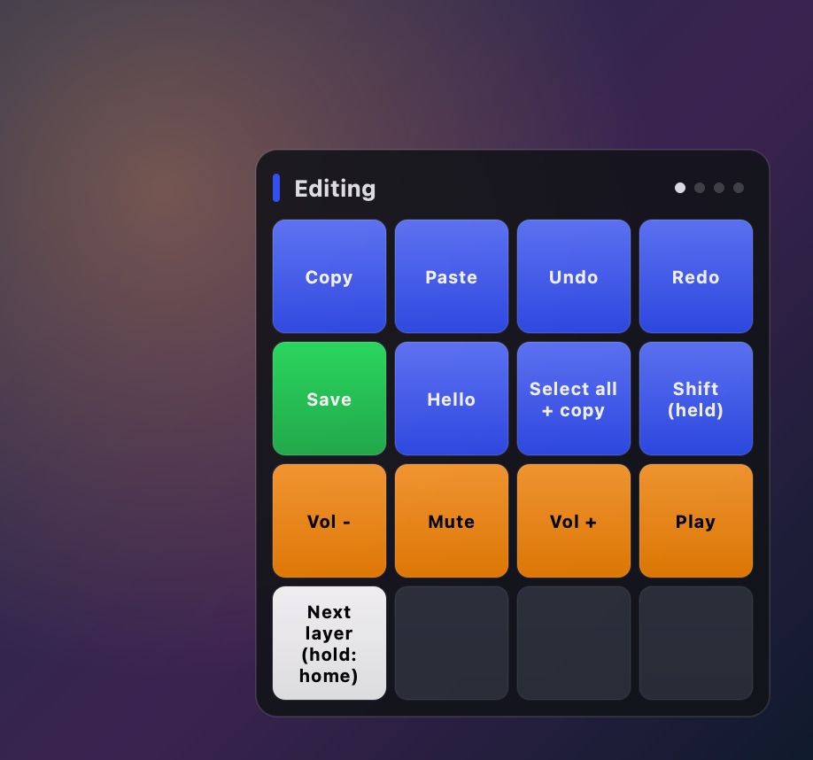
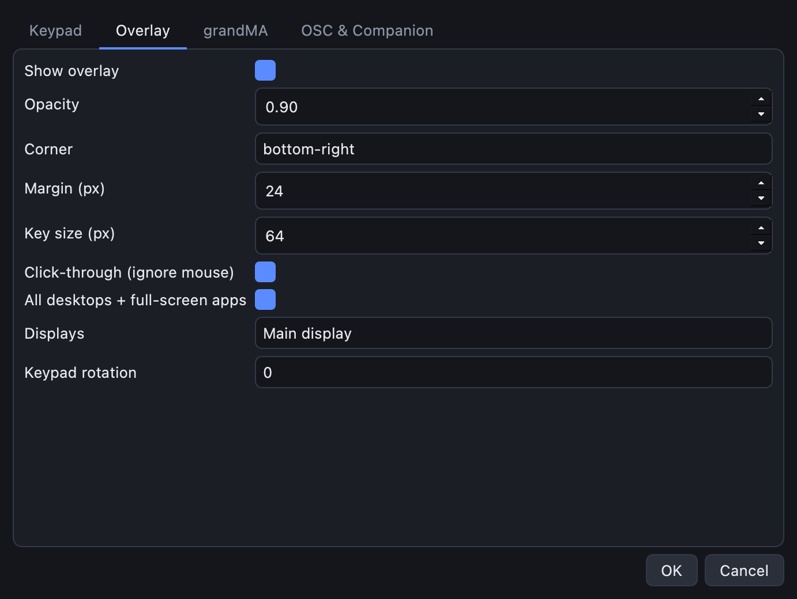

# The on-screen overlay

The overlay is a small, semi-transparent window that stays on top of everything. It shows the
current layer and what every key does, so you don't need to memorise your keypad or label the keys.



- **Header:** the layer's colour and name, and one dot per layer (the bright one is the current layer).
- **Status**, in the header: *keypad offline* when the keypad isn't connected, or the Companion status
  and page on a Companion layer. Long text scrolls so you can read all of it.
- **Keys:** each key's label and colour, laid out like the keypad. Keys you're holding down light up.

Show or hide it with the **Overlay** button in the editor's toolbar (**View → Overlay**,
Ctrl/Cmd+Shift+O).

## Settings

**Settings → Overlay**:

| Setting | What it does |
|---|---|
| **Show overlay** | whether this layout shows an overlay at all |
| **Opacity** | 0.1 (faint) to 1 (solid) |
| **Corner** / **Margin** | which screen corner, and the gap to the edge |
| **Key size** | size of each key in pixels; the overlay grows to fit |
| **Click-through** | on: clicks go to the window underneath. Off: click keys to trigger them, scroll to change layer, right-click for the next layer |
| **All desktops + full-screen apps** | macOS: keep the overlay on every Space and above full-screen apps |
| **Displays** | main display, all displays, the display with the mouse pointer, or chosen displays |
| **Keypad rotation** | if your keypad sits sideways or upside down, turn the overlay (and the editor) to match |



## Change the opacity from the keypad

Add an **Overlay** action to a key. With **Operation: cycle**, each press steps through opacity
levels, 90 % → 60 % → 30 % → hidden → 90 % … (change them in **Opacity levels**, e.g. `[1, 0.5, 0]`).
The other operations are **toggle**, **show** and **hide**. The demo's Companion layer has one on the
bottom-right key (**Overlay opacity**).

## Overlay without the editor

On a show machine you may want the overlay and the network bridges without the editor:

```bash
cuekeys overlay my-layout.json
```

It adds an icon to the system tray to show/hide the overlay or quit.

## Platform notes

- **macOS:** the overlay follows you to every Space (Ctrl+←/→) and shows above full-screen apps
  when **All desktops + full-screen apps** is on.
- **Windows:** it stays on top, but only on the virtual desktop where it opened.
- **Linux:** on Wayland the app runs through XWayland, because Wayland doesn't let windows keep
  themselves on top. It isn't pinned to every workspace yet.

With several keypads, each has its own overlay: see [Several keypads](several-keypads.md).
