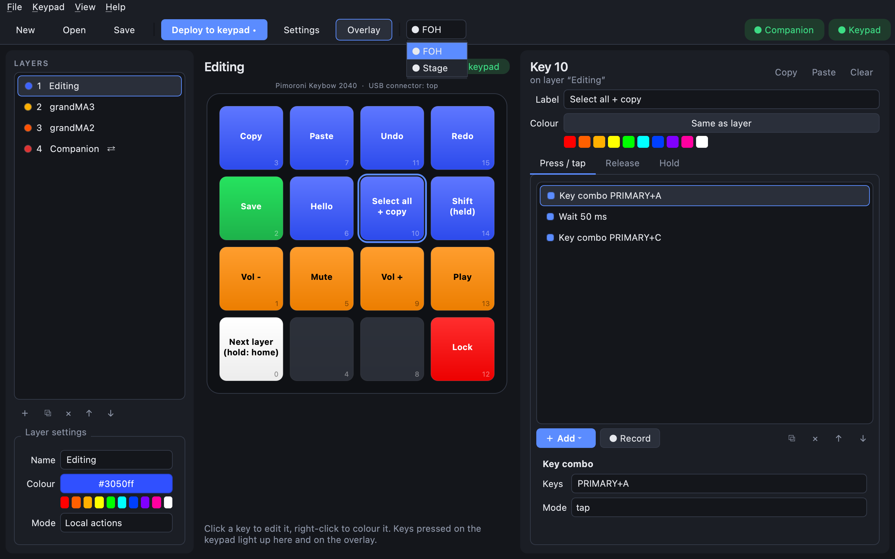
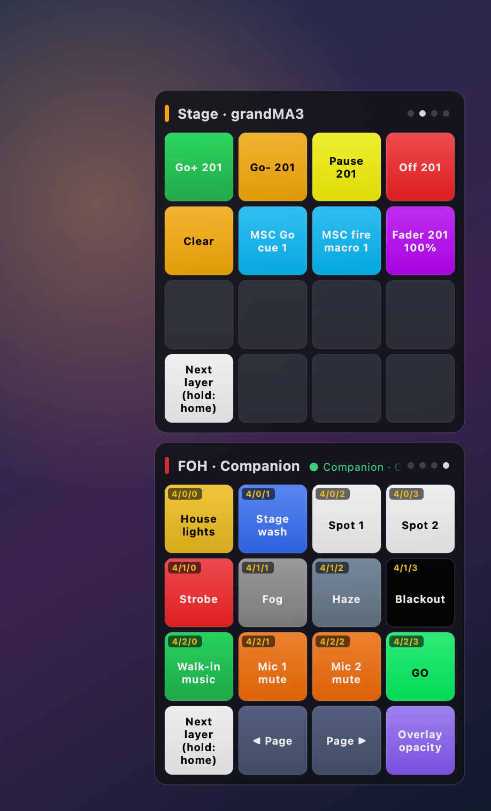

# Several keypads

Plug in as many keypads as you like. CueKeys tells them apart by their hardware ID (every RP2040
chip has a unique one), so it doesn't matter which USB port you use or in which order you plug them
in.

## Pick the keypad you're editing

The picker in the toolbar lists every keypad CueKeys knows. ● means connected, ○ means not connected
right now.



Everything in the editor applies to the keypad selected there: its layout, **Deploy**, **Install
firmware**, **Open CIRCUITPY drive** and **LED colour balance**.

With no keypad plugged in, the picker shows **No keypad** and you can still edit a layout. When a
keypad arrives, the editor switches to it and keeps the layout you were editing.

## Name them

**Keypad → Rename keypad…** gives the selected keypad a name, like *FOH* or *Stage*. The name shows in
the picker, on its overlay, and in Companion's surface list.

## Give each keypad its own layout

Each keypad remembers its own layout file:

- **File → Open** or **File → Save As** with a keypad selected makes that file its layout.
- Several keypads can use **the same file**; edits then apply to all of them.
- A keypad you haven't given a layout uses the one you opened last.

Some things belong to the physical keypad rather than the layout, and stay with it whatever layout
it uses: its **name** and its **LED colour balance**.

## One overlay per keypad

Each keypad gets its own overlay, stacked in the corner. With more than one, each overlay's header
starts with the keypad's name. A keypad's overlay key (see [overlay](overlay.md)) only changes its
own overlay.



## Companion

Each keypad's Companion layers are separate surfaces in Companion, named *CueKeys FOH · Companion*,
*CueKeys Stage · Companion* and so on, so two keypads with the same layout can show different pages.

## From the command line

```bash
cuekeys keypads                          # list connected and remembered keypads
cuekeys keypads rename e35b8c2b FOH      # by the last 8 characters of its ID, or its name
cuekeys keypads assign FOH show.json     # the layout this keypad uses
cuekeys deploy show.json --keypad Stage  # deploy to one keypad
cuekeys install-firmware --keypad Stage
```

`--port` on `cuekeys gui`, `overlay` and `bridge` limits CueKeys to the keypad on that serial port.
